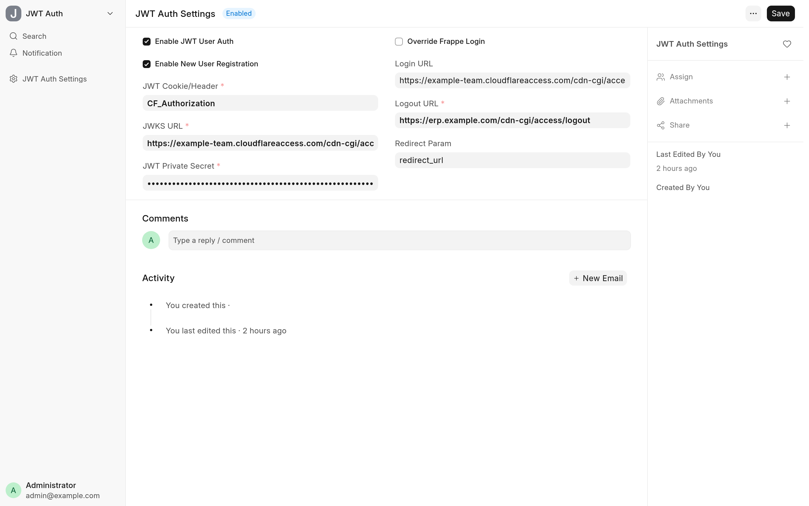
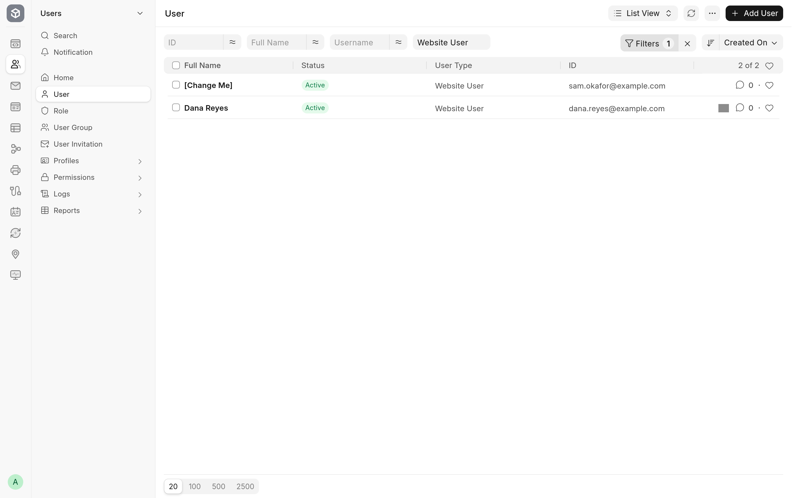

<!-- Copyright (c) 2026, Avunu LLC and contributors
For license information, please see license.txt-->

<!-- frappe-nix:begin header -->

<div align="center">


# JWT Bearer Authentication

JWT single sign-on for Frappe via Cloudflare Access or another JWKS provider

[](https://github.com/Avunu/jwt_bearer_auth/actions/workflows/ci.yml)
[](https://github.com/Avunu/jwt_bearer_auth/releases)
[](license.txt)
[](https://github.com/frappe/frappe/tree/version-16)

<picture>
  <source media="(prefers-color-scheme: dark)" srcset="docs/screenshots/settings-dark.webp">
  
</picture>

</div>

<!-- frappe-nix:end header -->

## Overview

JWT Bearer Authentication signs people in to a Frappe site from the JSON Web Token (JWT) that an identity provider in front of the site attaches to each request. Cloudflare Access is the provider it is built and used with; any provider that signs RS256 tokens and publishes its keys at a JWKS URL works the same way.

It is for teams that already sign in through an identity provider and don't want a second Frappe password to manage. The identity provider decides who someone is, and Frappe logs that person in from the signed token without asking for a Frappe password.

## Features

- **Token login.** On each request from a visitor who is not logged in, the app reads the JWT from the cookie or header you name and logs in the Frappe user whose email the token carries.
- **Verified tokens.** A token must be RS256, signed by a key from the provider's JWKS endpoint and issued for your application's audience. With no audience set, every token is rejected.
- **User registration.** When it is on, a valid token for an email with no user creates a Website User, filled in from a Contact with that email where one exists. Without a Contact, or with a Contact that has no first name, the new user is sent to the profile page to complete their details.
- **Contact login.** A token whose email matches a Contact that is already linked to a user logs in that user.
- **Logout through the provider.** Logging out of the desk or the website ends the Frappe session and then sends the browser to the provider's logout URL, so the provider's session ends too and the next request doesn't log the user straight back in.
- **Contact sync.** Name, phone, mobile and gender changes on a Contact that is linked to a user are copied to that user. A Contact named `[Change Me]` by registration is renamed once it has a real name.

<picture>
  <source media="(prefers-color-scheme: dark)" srcset="docs/screenshots/registered-users-dark.webp">
  
</picture>

<!-- frappe-nix:begin compatibility -->

## Compatibility

| Frappe | Branch       |
| ------ | ------------ |
| v16    | `version-16` |

<!-- frappe-nix:end compatibility -->

<!-- frappe-nix:begin installation -->

## Installation

On Frappe Cloud, install JWT Bearer Authentication from the [Frappe marketplace](https://cloud.frappe.io/marketplace/apps/jwt_bearer_auth).

On a bench of your own:

```bash
bench get-app https://github.com/Avunu/jwt_bearer_auth --branch version-16
bench --site <site> install-app jwt_bearer_auth
```

<!-- frappe-nix:end installation -->

## Configuration

Open **JWT Auth Settings** from the desk search. You need an identity provider that issues JWTs; for Cloudflare Access, put the site behind an Access application first.

| Setting                          | What it does                                                                                                                                                                     |
| -------------------------------- | -------------------------------------------------------------------------------------------------------------------------------------------------------------------------------- |
| **Enable JWT User Auth**         | Turns token login on.                                                                                                                                                            |
| **Enable New User Registration** | Creates a user when a valid token names an email with no user yet.                                                                                                               |
| **Override Frappe Login**        | Meant to send visitors on Frappe's login page to the provider's **Login URL**; see [Limitations](#limitations).                                                                  |
| **JWT Cookie/Header**            | The cookie or header that carries the token. The cookie is checked first. For Cloudflare Access, `CF_Authorization` (cookie) or `Cf-Access-Jwt-Assertion` (header).              |
| **JWKS URL**                     | The provider's public keys. For Cloudflare Access, `https://<team>.cloudflareaccess.com/cdn-cgi/access/certs`.                                                                   |
| **JWT Private Secret**           | The audience the token must be issued for. For Cloudflare Access, the application's AUD tag. It is stored as a password field. Without it, every token is rejected.              |
| **Logout URL**                   | Where users are sent after logging out.                                                                                                                                          |
| **Login URL**                    | Used only by **Override Frappe Login**, so it currently has no effect; see [Limitations](#limitations).                                                                          |
| **Redirect Param**               | The query parameter that carries the page to return to, added to the logout URL (and to the login URL once the override works). Leave it empty if the provider doesn't take one. |

Troubleshooting notes are in the [documentation](docs/README.md#troubleshooting).

## How It Works

- **`auth_hooks`** runs `jwt_bearer_auth.auth.validate_auth` on every request. When the visitor is a Guest and token login is on, it reads the token, fetches the keys from the JWKS URL, and decodes the token with PyJWT against each key, checking the RS256 signature and the audience. A valid token's `email` claim picks the user: an existing User with that email, else the user linked to a Contact with that email, else a new user when registration is on. The user is then logged in with Frappe's login manager.
- **Registration** inserts the User (and links it to the matching Contact) inside the request, and asks Frappe to commit at the end of the request rather than committing part-way through.
- **`after_request`** runs `jwt_bearer_auth.auth.handle_redirects`, which applies the redirect to the provider after logout, the redirect to the profile page after registration, and the login override. A newly registered user who lands on `/me` is sent back to the page they first asked for.
- **Logout.** `on_logout` records the provider's logout URL for the response. The desk's **Log out** is replaced by a small bundle (`app.bundle.ts`) that calls `jwt_bearer_auth.auth.jwt_logout` and follows the URL it returns. On the website, the **Log out** link in the account menu calls `jwt_bearer_auth.auth.web_logout`.
- **Contact sync** is a `doc_events` hook on Contact's `on_update`.

## Limitations

- Only RS256 tokens are accepted, and only the `email` claim is used to find the user. Issuer and expiry are checked only as far as PyJWT's defaults go (expiry is checked when the token has an `exp` claim; the issuer is not checked).
- The JWKS is fetched again for every token it checks, with no cache, so each login from a token makes one request to the provider.
- Users created by registration are Website Users. Give them roles and desk access by hand if they need it.
- The app does not check that a request came through the identity provider: any client holding a valid token for the audience can send it in the cookie or header. Keep the site reachable only through the provider.
- **Override Frappe Login** has no effect at present: the redirect compares the request path with `login`, but Frappe's request paths start with `/`, so the check never matches. Visitors who reach `/login` see Frappe's login page.
- One identity provider per site: the settings hold a single JWKS URL, audience, and cookie or header name.

<!-- frappe-nix:begin support -->

## Support

- Bug reports and questions: [GitHub issues](https://github.com/Avunu/jwt_bearer_auth/issues)
- E-mail: <mail@avu.nu>

<!-- frappe-nix:end support -->

<!-- frappe-nix:begin development -->

## Development

```bash
nix develop        # or: direnv allow
prek install       # the git hooks CI runs
frappe-test        # the tests, the way CI runs them
```

The managed files, checks and release flow are described in the [app standards documentation](https://docs.avunu.net/frappe-nix/docs/app-standards/).

<!-- frappe-nix:end development -->

<!-- frappe-nix:begin license -->

## License

MIT, Copyright (c) 2024–present Avunu LLC → [license.txt](license.txt)

<!-- frappe-nix:end license -->
